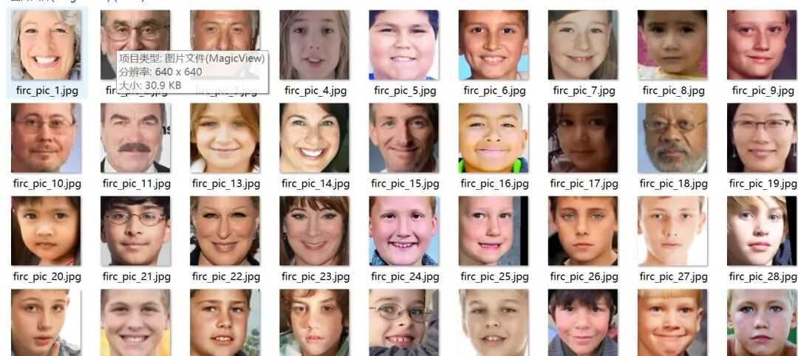
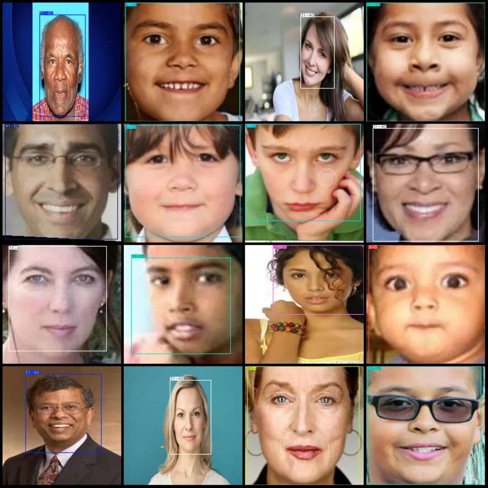
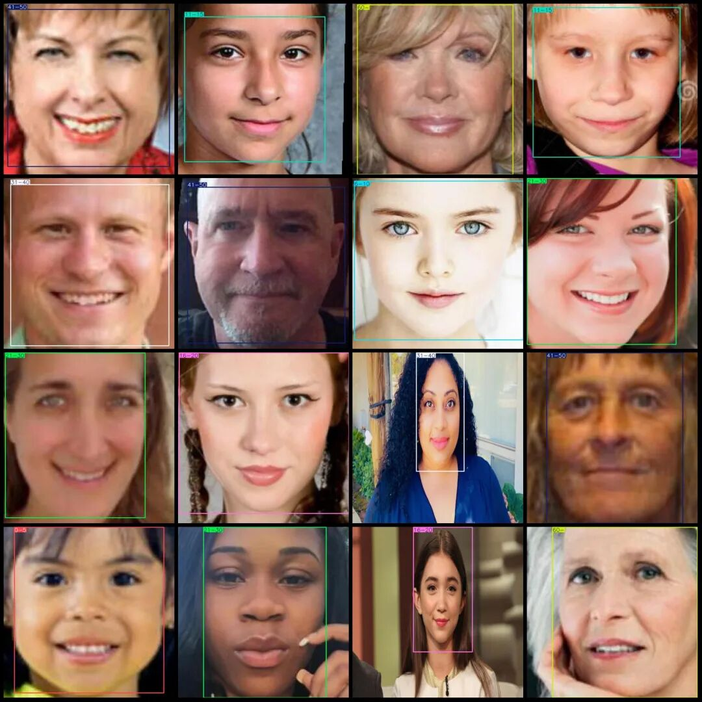

# Age Detection Age Classification Dataset VOC+YOLO format with 2834 images in 9 categories

Dataset format: Pascal VOC format + YOLO format (txt file without split path, only containing jpg images and corresponding VOC format xml files and yolo format txt files)

Number of images (number of jpg files): 2834

Number of annotations (number of xml files): 2834

Number of annotations (number of txt files): 2834

Label category count: 9

Label category names (Note that the order of yolo format categories does not correspond to this, but is based on the labels folder's classes.txt): ["0-5","6-10","11-15","16-20","21-30","31-40","41-50","51-60","60-"]

Number of boxes labeled in each category:

0-5 frames = 186

6-10 Frames = 194

11-15 Frames = 398

16-20 Frames = 354

21-30 Frames = 272

31-40 Frames = 550

41-50 Frames = 336

51-60 Frames = 361

60- Frames = 198

Total frame count: 2850

Number of images per category:

0-5 Ownership of images = 186

6-10 Number of images owned = 193

11-15 Ownership of images = 397

16-20 Num of images owned = 354

21-30 Ownership of images = 272

31-40 Number of images owned = 548

41-50 Number of images owned = 330

51-60 Number of images owned = 358

60 - Number of images owned = 198

Image resolution: 640x640

Using labelImg:

Annotation rules: Draw a rectangle around the category.

Important Notice: The dataset does not have separate training, validation, and test sets; you need to partition them yourself.

Special : This dataset does not guarantee the accuracy of the trained models or weight files.

Image Preview:

Annotation example:

## Payment

Here is a pay link on Stripe ( https://buy.stripe.com/3cs8yP7sY87d0vu9AB ). Please contact me lonlonago@foxmail.com after funding $89, and I will send you a complete data files , thank you!

